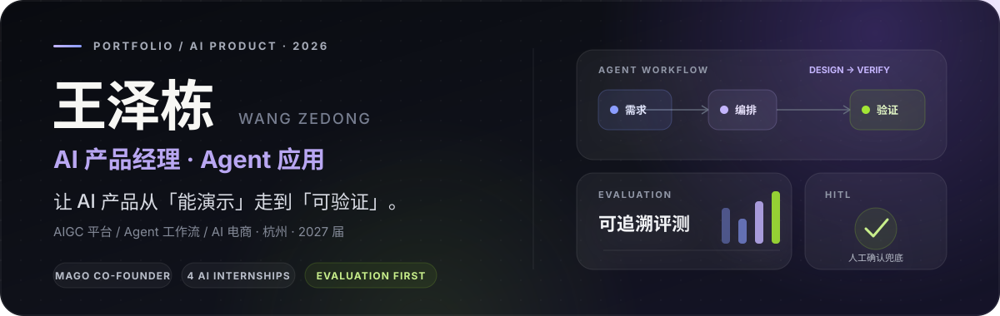
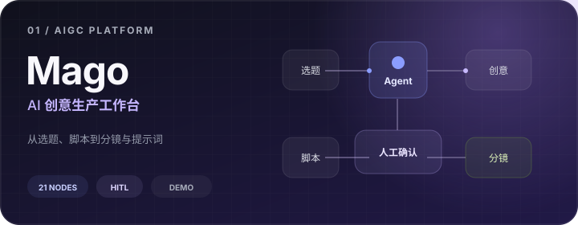
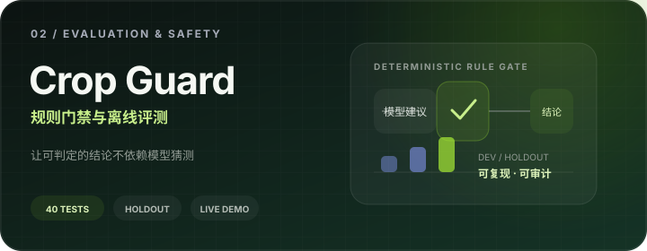
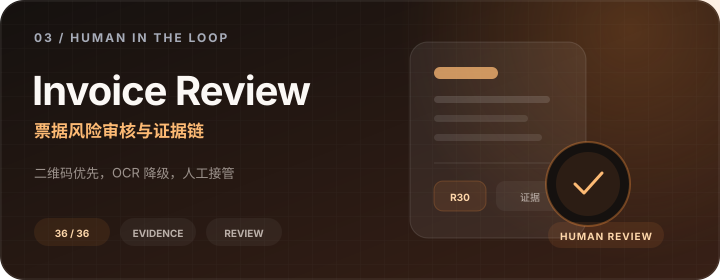

  
   
  2027 届 · 浙江农林大学智慧农业本科 · AI 产品经理 / AI 应用与 Agent / AI 电商产品
    
  <a href="#selected-work"><strong>SELECTED WORK</strong></a>&nbsp;&nbsp;·&nbsp;&nbsp;
  <a href="#how-i-work"><strong>HOW I WORK</strong></a>&nbsp;&nbsp;·&nbsp;&nbsp;
  <a href="#more-work"><strong>MORE WORK</strong></a>&nbsp;&nbsp;·&nbsp;&nbsp;
  <a href="mailto:wangzedong2027@foxmail.com"><strong>CONTACT</strong></a>

 

> 我关注的不是“模型能否生成一个答案”，而是如何把**需求判断、工作流、可追溯评测和人工兜底**组成真正可用的产品。

## Selected Work / 精选作品

<table>
  <tr>
    <td width="33.33%" valign="top">
      
        
      <strong>Mago AIGC Platform</strong> 
      多模型聚合与 Agent 创意工作台，覆盖选题、脚本、分镜和提示词生产。  
      <a href="https://github.com/cangyuyi/Mago-AIGC-Platform#readme">查看架构与运行说明 →</a>
    </td>
    <td width="33.33%" valign="top">
      
        
      <strong>crop-guard-agent</strong> 
      将合规规则与模型建议分离，用留出集和安全门禁验证高风险工作流。  
      <a href="https://cangyuyi.github.io/crop-guard-agent/docs/">在线 Demo</a> · <a href="https://github.com/cangyuyi/crop-guard-agent/blob/main/docs/method.md">方法文档 →</a>
    </td>
    <td width="33.33%" valign="top">
      
        
      <strong>invoice-risk-review-agent</strong> 
      二维码优先、OCR 降级，结合确定性风险规则、证据链与人工复核。  
      <a href="https://cangyuyi.github.io/invoice-risk-review-agent/">交互 Demo</a> · <a href="https://github.com/cangyuyi/invoice-risk-review-agent#评测证据">评测证据 →</a>
    </td>
  </tr>
</table>

## How I Work / 我的工作方式

<table>
  <tr>
    <td width="33.33%" valign="top">
      01 / DISCOVER  
      <strong>先判断，再选择模型</strong>  
      从真实用户任务出发，区分哪些环节需要语义智能，哪些环节应该使用确定性规则。
    </td>
    <td width="33.33%" valign="top">
      02 / ORCHESTRATE  
      <strong>设计完整工作流</strong>  
      把模型、工具、数据和人工确认组织成可运行的系统，而不是堆叠 Agent 数量。
    </td>
    <td width="33.33%" valign="top">
      03 / VERIFY  
      <strong>让结果可以被验证</strong>  
      用评测集、规则门禁、失败案例和证据链检查结果，明确原型与生产系统的边界。
    </td>
  </tr>
</table>

## More Work / 更多作品

  
<strong>产品原型与工程作品</strong>　Muse Canvas / 飞书 CLI / TaskMate / Outbound

   
  <table>
    <tbody>
      <tr><td width="25%"><a href="https://github.com/cangyuyi/muse-canvas"><strong>Muse Canvas</strong></a></td><td>AI 视频无限画布：节点编排、素材引用、任务队列与浏览器会话桥接。</td><td width="20%">Next.js · React Flow</td></tr>
      <tr><td><a href="https://github.com/cangyuyi/feishu-cli-bot"><strong>飞书 CLI 助手</strong></a></td><td>本地飞书 AI 助手，支持 23 个工具、function calling、写操作开关与跨平台运行。</td><td>Python · Agent</td></tr>
      <tr><td><a href="https://github.com/cangyuyi/taskmate"><strong>TaskMate</strong></a></td><td>本地优先的 Android 待办与电脑端控制台，支持提醒、重复任务和双向同步。</td><td>Kotlin · FastAPI</td></tr>
      <tr><td><a href="https://github.com/cangyuyi/OutboundCopilot"><strong>Outbound Copilot</strong></a></td><td>飞书表格与对话平台之间的话术测试桌面辅助工具。</td><td>JavaScript · RPA</td></tr>
    </tbody>
  </table>

  
<strong>方法、评测与 Agent Skills</strong>　电商评测 / 企业研究 / 简历写作

   
  <table>
    <tbody>
      <tr><td width="25%"><a href="https://github.com/cangyuyi/shance-commerce-agent-portfolio"><strong>商策 Agent</strong></a></td><td>电商内容评测框架；Benchmark 为预置演示数据，不是已实测的 LLM 成绩。</td></tr>
      <tr><td><a href="https://github.com/cangyuyi/ai-pm-sop"><strong>AI PM 简历写作 Skill</strong></a></td><td>证据优先的简历诊断与改写 SOP，不替用户编造经历。</td></tr>
      <tr><td><a href="https://github.com/cangyuyi/employer-research-skill"><strong>企业研究 Skill</strong></a></td><td>证据优先的企业与行业求职研究，支持来源核验和离线检查。</td></tr>
    </tbody>
  </table>

  
<strong>求职工具与工程探索</strong>　网申 SOP / 求职攻略 / 浏览器游戏

   
  <table>
    <tbody>
      <tr><td width="25%"><a href="https://github.com/cangyuyi/campus-apply-copilot"><strong>网申人机协作 SOP</strong></a></td><td>专注 ATS 填表和登录、提交交接；投递数量不是仓库可自动验证指标。</td></tr>
      <tr><td><a href="https://github.com/cangyuyi/china-job-search-playbook"><strong>求职通关攻略</strong></a></td><td>岗位核验、材料、面试与 Offer 全流程 Skill。</td></tr>
      <tr><td><a href="https://github.com/cangyuyi/midnight-survivors"><strong>长夜收割者</strong></a></td><td>TypeScript 浏览器游戏工程练习；目前未指定开源许可证。</td></tr>
      <tr><td><a href="https://github.com/cangyuyi/dawn-survivors"><strong>黎明幸存者</strong></a></td><td>早期构建产物展示，仓库不含可供审查的源代码。</td></tr>
      <tr><td><a href="https://github.com/cangyuyi/BossHunter"><strong>BossHunter</strong></a></td><td>社区项目的 Fork，不列作本人原创项目。</td></tr>
    </tbody>
  </table>

## Stack / 技术与方法栈

<table>
  <tr>
    <td width="33.33%" valign="top">PRODUCT  <strong>需求洞察 · 0→1 落地</strong> 工作流设计 / 交互原型 / 人机协作 / 风险兜底</td>
    <td width="33.33%" valign="top">AI &amp; EVALUATION  <strong>Agent · RAG · Tool Calling</strong> LangGraph / Dify / LLM Evaluation / HITL</td>
    <td width="33.33%" valign="top">ENGINEERING  <strong>Python · TypeScript · Kotlin</strong> Next.js / FastAPI / Go / React Flow</td>
  </tr>
</table>

  
关于公开作品、业务材料与测试数据的统计口径

   
  业务实践与独立原型分层呈现。公开代码用于核查实现和方法，不自动证明线上业务结果；测试数字的样本、数据类型与复现命令以各仓库 README 为准。具体业务指标与职责范围以面谈时可合规提供的材料为准。

 

  OPEN TO AI PRODUCT / AGENT / AI COMMERCE OPPORTUNITIES  
  <strong>如果你也在做 AI 产品、Agent 应用或 AI 电商，欢迎交流。</strong>  
  <a href="mailto:wangzedong2027@foxmail.com"><strong>wangzedong2027@foxmail.com</strong></a>&nbsp;&nbsp;·&nbsp;&nbsp;
  <a href="https://github.com/cangyuyi/cangyuyi/issues"><strong>GitHub Issues</strong></a>

